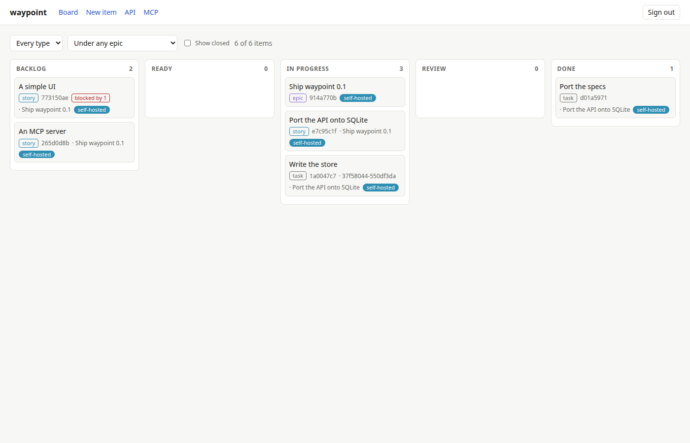

# waypoint

A task tracker with dependency and status management. Tasks can wait on other
tasks, and waypoint keeps a task from being started before what it waits on is
closed, or finished before its acceptance criteria are met.

One Node process serves an HTTP API, an MCP server and a web page, and keeps
everything in one SQLite file.

```sh
npx github:dakotacolorado/waypoint
```

(It installs from this repo and builds itself; `npx @dakotajp/waypoint` once it is on npm.)

```
██╗    ██╗ █████╗ ██╗   ██╗██████╗  ██████╗ ██╗███╗   ██╗████████╗    ▄▄████▄▄
██║    ██║██╔══██╗╚██╗ ██╔╝██╔══██╗██╔═══██╗██║████╗  ██║╚══██╔══╝   ███▀  ▀███
██║ █╗ ██║███████║ ╚████╔╝ ██████╔╝██║   ██║██║██╔██╗ ██║   ██║      ███▄  ▄███
██║███╗██║██╔══██║  ╚██╔╝  ██╔═══╝ ██║   ██║██║██║╚██╗██║   ██║       ████████
╚███╔███╔╝██║  ██║   ██║   ██║     ╚██████╔╝██║██║ ╚████║   ██║        ▀████▀
 ╚══╝╚══╝ ╚═╝  ╚═╝   ╚═╝   ╚═╝      ╚═════╝ ╚═╝╚═╝  ╚═══╝   ╚═╝          ██
📍 v0.2.0

Know where the work is, and what it waits on.
A task tracker with dependency and status management.

  ▸ Page      http://127.0.0.1:4400/
  ▸ API       http://127.0.0.1:4400/tasks   docs http://127.0.0.1:4400/docs/api
  ▸ MCP       http://127.0.0.1:4400/mcp     docs http://127.0.0.1:4400/docs/mcp

admin token (shown once, kept only as a hash): wp_…

  listening on http://127.0.0.1:4400, data in ~/.waypoint/waypoint.db
  Ctrl+C to stop.
```

Node 24 or later; nothing else.

## Quick start

1. Run it, and keep the admin token it prints: it is shown once.
2. Open http://127.0.0.1:4400/ and paste the token to sign in.
3. Create a task with **New task**, or through the API or MCP below.



The page shows the board by status, which tasks are ready and which are blocked, and each task's criteria, subtasks, dependencies, comments and history.

## How it works

- `status` is one of `backlog`, `in_progress`, `review`, `done` or `cancelled`. `done` and `cancelled` are the closed statuses.
- A task **depends on** other tasks, and is **ready** when it is in `backlog` and every task it depends on is closed.
- A task can move to `in_progress`, `review` or `done` once every task it depends on is closed, and to `done` once every criterion is met and every subtask is closed.
- A task's **subtasks** are the steps of its work, with dependencies among themselves held to the same rule. Its **criteria** are what must be true for it to be done.
- **Labels** group tasks. **Comments** sit beside a task without changing it, and its **history** records every write.

## The API

Fourteen operations, named as AWS names theirs:

| Operation | |
|---|---|
| `ListTasks`, `CreateTask`, `GetTask`, `UpdateTask`, `DeleteTask` | `/tasks`, `/tasks/{taskId}` |
| `ListTaskHistory` | `/tasks/{taskId}/history` |
| `ListComments`, `CreateComment` | `/tasks/{taskId}/comments` |
| `ListLabels`, `CreateLabel`, `GetLabel`, `UpdateLabel`, `DeleteLabel` | `/labels`, `/labels/{labelId}` |
| `GetHealth` | `/health` |

The reference is [`docs/API.md`](./docs/API.md), served at `/docs/api`; the contract is [`openapi.json`](./openapi.json).

```sh
curl -s -H "authorization: Bearer $TOKEN" -H 'content-type: application/json' http://127.0.0.1:4400/tasks -d '{
  "title": "Write the README",
  "criteria": [{ "text": "Says how to run it" }],
  "subtasks": [{ "title": "Draft it" }, { "title": "Review it", "dependsOn": ["s1"] }]
}'
curl -s -H "authorization: Bearer $TOKEN" 'http://127.0.0.1:4400/tasks?ready=true'
```

## MCP

`/mcp` serves the same operations as tools, named the same in snake_case (`list_tasks`, `update_task`, …), each one API request under the caller's token. Point a client at it:

```json
{ "mcpServers": { "waypoint": { "type": "http", "url": "http://127.0.0.1:4400/mcp", "headers": { "Authorization": "Bearer wp_…" } } } }
```

With Claude Code:

```sh
claude mcp add --transport http waypoint http://127.0.0.1:4400/mcp --header "Authorization: Bearer wp_…"
```

The tools are listed in [`docs/MCP.md`](./docs/MCP.md), served at `/docs/mcp`.

## Tokens

Every request but `GetHealth` takes a bearer token. Tokens are kept as hashes, so each is shown only when made:

```sh
waypoint token create alice --admin
waypoint token create builds        # a token several callers share; each says who it is by x-actor
waypoint token list
waypoint token revoke builds
```

A write is recorded as its `x-actor` header, else its token's name. `WAYPOINT_ADMIN_TOKEN`, if set, is an admin token too, never stored. With no admin token at all, `waypoint` makes one and prints it.

## Options

| Flag | Environment | Default |
|---|---|---|
| `--host` | `WAYPOINT_HOST` | `127.0.0.1` |
| `--port` | `WAYPOINT_PORT` | `4400` |
| `--db` | `WAYPOINT_DB` | `~/.waypoint/waypoint.db` |
| `--public-url` | `WAYPOINT_PUBLIC_URL` | its own address: what the banner and served docs give, behind a proxy |

`waypoint backup copy.db` takes SQLite's online backup of the database, consistent while it serves.

## Developing

```sh
npm ci               # also builds, and points git at .githooks/
npm run dev          # the server on .waypoint-dev.db
npm run typecheck
npm test
npm run build
```

`src/schema.ts` is the source of `openapi.json` and the API's docs; `src/mcp.ts` of `mcp.json` and the MCP docs. `npm run spec` regenerates them, as the pre-commit hook does, and a test fails if any drifts. The page is `ui/`.

## License

MIT
